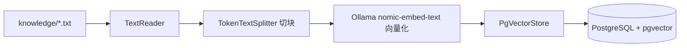

# 系统架构

企业知识库智能助手的架构分为"请求处理主链路"和"知识入库写侧"两条线，所有组件基于 Spring AI 2.0 的抽象搭建。

## 请求处理主链路

```mermaid
flowchart TD
    U[浏览器 /api/chat] --> C[ChatController]
    C --> S[ChatService.chat]
    S --> I[IntentClassifier 意图识别]
    I -->|KNOWLEDGE| R[QuestionAnswerAdvisor 检索增强]
    I -->|HR / ORDER| T[@Tool 工具调用]
    I -->|CHITCHAT| D[纯对话]
    R --> V[PgVectorStore 相似度检索]
    V --> P[(PostgreSQL + pgvector)]
    R --> M[MessageChatMemoryAdvisor 多轮记忆]
    T --> M
    D --> M
    M --> O[Ollama qwen2.5:7b]
    O -->|Flux 流式| C
    C -->|SSE| U
```

## 写侧：知识入库



## 关键设计决策

| 设计 | 选择 | 理由 |
|---|---|---|
| 意图识别 | 结构化输出 `.entity(QueryIntent.class)` | 四类意图明确，结构化比关键词匹配准 |
| 向量库 | PGVector（HNSW 索引，768 维） | 复用 Postgres，重启不丢，维度匹配 nomic-embed-text |
| 流式返回 | SSE + `ResponseBodyEmitter` | 逐字输出，体验好 |
| 记忆 | `MessageChatMemoryAdvisor` | 按 sessionId 隔离多轮上下文 |
| 容错 | Resilience4j：重试/熔断/限流 + `onErrorResume` 降级 | 模型挂了返回兜底话术，不把异常甩给用户 |
| 可观测 | Micrometer + actuator | `gen_ai.*` 指标看 token、耗时；`log-prompt=false` 保护隐私 |

## 一分钟讲稿

请求进来先做意图分类，用 Spring AI 的结构化输出把问题分成知识问答、人事查询、订单查询和闲聊四类。然后按类分流：知识问答走 RAG，从 PGVector 里检索相似片段注入 prompt；人事和订单走工具调用；闲聊直接对话。所有分支都过记忆 Advisor 带上多轮上下文，最后模型流式输出，通过 SSE 推给前端。意图识别这层单独抽成 Bean 加了 Resilience4j 容错，因为它是必经之路。
