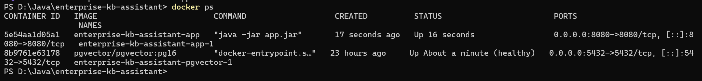
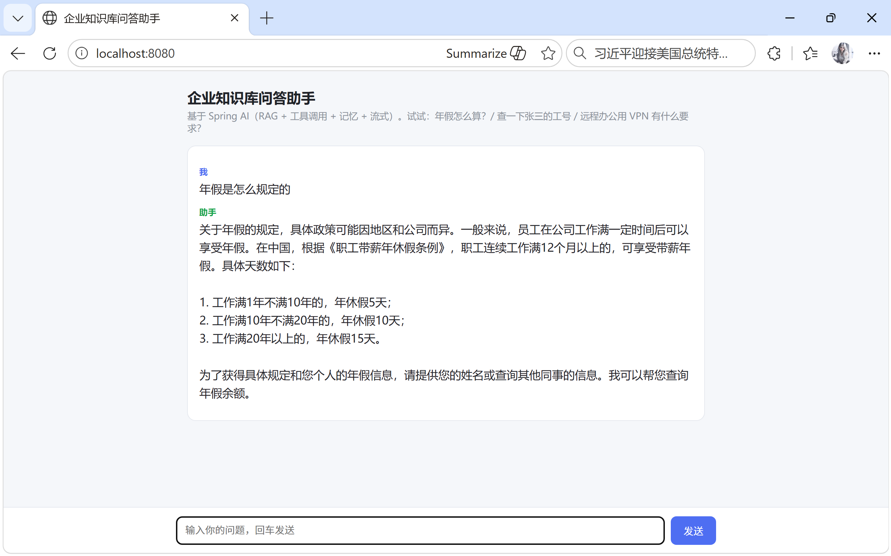

# 企业知识库智能助手（Enterprise KB Assistant）

基于 **Spring AI 2.0** 的企业知识库问答系统。员工可以用自然语言查询公司制度、人事信息和订单状态，支持多轮对话和流式输出。

> 技术栈：Spring Boot 4.1.2 · Spring AI 2.0.2 · Java 17 · Ollama · PostgreSQL + pgvector · Resilience4j

## 核心能力

- **意图路由**：结构化输出识别 KNOWLEDGE / HR / ORDER / CHITCHAT 四类问题，分流到不同处理链
- **RAG 检索增强**：文档切块 → 向量化 → PGVector 持久化 → 相似度检索注入 prompt，回答有据可依
- **工具调用**：`@Tool` 暴露人事/订单查询，模型自动决定何时调用
- **多轮记忆**：按 sessionId 隔离会话，`MessageChatMemoryAdvisor` 承接"他""它"这类指代
- **流式输出**：SSE + `ResponseBodyEmitter` 逐字返回
- **生产化**：PGVector 持久化（重启不丢库）、Resilience4j 重试/熔断/限流、`gen_ai.*` 可观测指标

## 架构

详见 [ARCHITECTURE.md](ARCHITECTURE.md)（含 Mermaid 流程图与关键设计决策）。

一句话链路：浏览器 → Controller → 意图识别 → RAG / 工具 / 纯聊 → 记忆 Advisor → 模型 → SSE 流式返回。

## 快速开始

### 前置条件

- JDK 17+、Maven 3.9+
- Ollama 已启动，并拉取两个模型：
  ```bash
  ollama pull qwen2.5:7b
  ollama pull nomic-embed-text
  ```
- Docker Desktop（用于启动 PGVector 数据库）

### 启动步骤

```bash
# 1. 启动数据库（只需这一条，不用起 ollama 容器——模型用本机的）
docker compose up -d pgvector

# 2. 编译并运行应用
mvn spring-boot:run

# 3. 首次启动会自动把 knowledge/*.txt 入库，看到日志：
#    [KB] 启动自动入库完成，共写入 N 个文档片段
```

浏览器打开 `http://localhost:8080` 即可聊天。

### 验证四类能力

```bash
# RAG：应基于 hr-policy.txt 回答
curl -N -X POST http://localhost:8080/api/chat -H 'Content-Type: application/json' \
  -d '{"sessionId":"demo","message":"年假是怎么规定的？"}'

# 工具调用：应返回工号 E1001
curl -N -X POST http://localhost:8080/api/chat -H 'Content-Type: application/json' \
  -d '{"sessionId":"demo","message":"查一下张三的工号"}'

# 记忆：应接住"他 = 张三"
curl -N -X POST http://localhost:8080/api/chat -H 'Content-Type: application/json' \
  -d '{"sessionId":"demo","message":"那他的年假还有几天？"}'

# 可观测：应看到 gen_ai.* 指标
curl -s http://localhost:8080/actuator/metrics
```

### 容器化部署验证

app 与数据库均已容器化，app 通过 `host.docker.internal` 访问宿主机 Ollama，避免重复下载大模型：

```bash
docker compose up -d --build app pgvector
```

两个容器正常运行（app + pgvector healthy）：



容器里的 app 基于知识库回答问题：



## 项目亮点

1. **完整的 Agent 编排**：意图识别 → 路由 → RAG / 工具 → 记忆 → 流式，不是简单调 API
2. **生产化改造实操**：内存向量库迁移到 PGVector，业务代码零改动；验证"重启不丢库"
3. **容错设计**：识别层抽独立 Bean 解决 AOP 自调用失效；流式链路用 `onErrorResume` 降级
4. **安全合规**：`log-prompt=false`，用户原文不进日志

## 关键配置

| 配置 | 值 | 说明 |
|---|---|---|
| `spring.ai.vectorstore.pgvector.dimensions` | 768 | 必须等于 nomic-embed-text 的向量维度 |
| `app.knowledge.top-k` | 4 | RAG 召回片段数 |
| `app.knowledge.similarity-threshold` | 0.55 | 相似度阈值，低于此值不采纳 |
| `spring.ai.chat.client.observations.log-prompt` | false | 不记录用户原文 |

## 常见问题

**Q：应用启动报 `UnsatisfiedDependencyException`？**
A：数据库容器没起。先执行 `docker compose up -d pgvector`，确认 5432 端口通再启动应用。

**Q：向量写入时报维度不匹配？**
A：`dimensions` 必须和 embedding 模型一致（nomic-embed-text = 768），别抄示例的 1536。

## 学习过程

从零手敲的全过程记录在 `BUILD_GUIDE.md` 与 `WEEK2/4/5/6_PLAYBOOK.md`：改需求、持久化迁移、可观测与容错的每一步都有讲解和踩坑记录。
