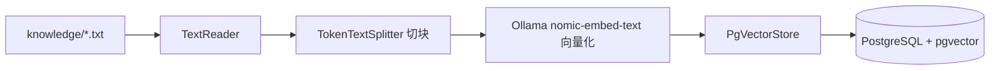

# 第六周 · 作品包装实现手册（照着做）

> 目标：把跑通的项目包装成"GitHub 点开即懂、面试能直接讲"的简历作品。
> 完成标准：仓库有清晰的 README + 架构图，Docker 部署验证通过，最新代码全部推上 GitHub。
> 技术栈：Spring Boot 4.1.2 + Spring AI 2.0.2 + Java 17 + Ollama + PGVector + Resilience4j。
> 前置：W2（改需求）、W4（PGVector）、W5（可观测 + 容错）都已跑通。

---

## 0. 先想明白：W6 和前几周不一样（面试直接能讲）

W2–W5 你在"造功能"，W6 是"卖作品"。面试官点开你 GitHub 的那 30 秒，决定他愿不愿意深挖。四件事的关系：

1. **架构图** —— 让他在 10 秒内看懂系统长什么样；
2. **README** —— 让他知道这项目解决什么问题、你做了什么、怎么跑起来；
3. **Docker 部署** —— 证明"能交付"，不是只能在 IDEA 里跑的玩具；
4. **推 GitHub** —— 把成品发布出去，简历上贴链接。

⚠️ 顺序别反：先把架构图和 README 定稿，再做部署和推送。否则 README 改一次、部署验证一次，反复返工。

---

## 1. 改动地图

| 步骤 | 文件 | 动作 |
|---|---|---|
| Step 1 | `ARCHITECTURE.md`（新建） | 写 Mermaid 架构图（GitHub 原生渲染） |
| Step 2 | `README.md`（**重写**） | 现状有乱码残留，整份重写成作品说明 |
| Step 3 | `docker-compose.yml`（小改） | 让 app 容器连**本机 Ollama**，不起 ollama 容器 |
| Step 4 | Git | 提交 + 推送全部改动 |

---

## 2. Step 1：画架构图（30 分钟，面试前必看）

在项目根目录新建 `ARCHITECTURE.md`。GitHub 原生支持 Mermaid，粘进去就能渲染成图，不用画图工具。

**先想清楚整条请求链路**（这也是你面试要脱稿讲的）：

```
浏览器 → /api/chat → ChatController → ChatService
       → IntentClassifier（意图识别，带 Resilience4j 容错）
       → 按意图分流：KNOWLEDGE→RAG / HR·ORDER→工具 / CHITCHAT→纯聊
       → Advisor 链（记忆 + RAG）→ Ollama 模型 → SSE 流式回浏览器
```

**要敲进 `ARCHITECTURE.md` 的内容**：

````markdown
# 系统架构

## 请求处理主链路

```mermaid
flowchart TD
    U[浏览器 /api/chat] --> C[ChatController]
    C --> S[ChatService.chat]
    S --> I[IntentClassifier 意图识别]
    I -->|KNOWLEDGE| R[QuestionAnswerAdvisor 检索增强]
    I -->|HR / ORDER| T[@Tool 工具调用]
    I -->|CHITCHAT| D[纯对话]
    R --> V[PgVectorStore 相似度检索]
    V --> P[(PostgreSQL + pgvector)]
    R --> M[MessageChatMemoryAdvisor 多轮记忆]
    T --> M
    D --> M
    M --> O[Ollama qwen2.5:7b]
    O -->|Flux 流式| C
    C -->|SSE| U
```

## 写侧：知识入库



## 关键设计决策

| 设计 | 选择 | 理由 |
|---|---|---|
| 意图识别 | 结构化输出 `.entity(QueryIntent.class)` | 四类意图明确，结构化比关键词匹配准 |
| 向量库 | PGVector（HNSW 索引，768 维） | 复用 Postgres，重启不丢，维度匹配 nomic-embed-text |
| 流式返回 | SSE + `ResponseBodyEmitter` | 逐字输出，体验好 |
| 记忆 | `MessageChatMemoryAdvisor` | 按 sessionId 隔离多轮上下文 |
| 容错 | Resilience4j：重试/熔断/限流 + `onErrorResume` 降级 | 模型挂了返回兜底话术，不把异常甩给用户 |
| 可观测 | Micrometer + actuator | `gen_ai.*` 指标看 token、耗时；`log-prompt=false` 保护隐私 |
````

**面试怎么讲这张图**（背下来）：
> "请求进来先做意图分类，用 Spring AI 的结构化输出把问题分成知识问答、人事查询、订单查询和闲聊四类。然后按类分流：知识问答走 RAG，从 PGVector 里检索相似片段注入 prompt；人事和订单走工具调用；闲聊直接对话。所有分支都过记忆 Advisor 带上多轮上下文，最后模型流式输出，通过 SSE 推给前端。意图识别这层单独抽成 Bean 加了 Resilience4j 容错，因为它是必经之路。"

## 3. Step 2：重写 README（20 分钟）

**为什么要整份重写**：你现在的 README 是"跟练脚手架说明"（教你怎么敲），不是"作品说明"（给面试官看）。而且末尾第 66–67 行有 UTF-16 编码残留的乱码（`# e n t e r p r i s e...`），点开就是黑历史。直接整份覆盖成下面这版。

**删掉旧文件全部内容，粘贴**：

````markdown
# 企业知识库智能助手（Enterprise KB Assistant）

基于 **Spring AI 2.0** 的企业知识库问答系统。员工可以用自然语言查询公司制度、人事信息和订单状态，支持多轮对话和流式输出。

> 技术栈：Spring Boot 4.1.2 · Spring AI 2.0.2 · Java 17 · Ollama · PostgreSQL + pgvector · Resilience4j

## 核心能力

- **意图路由**：结构化输出识别 KNOWLEDGE / HR / ORDER / CHITCHAT 四类问题，分流到不同处理链
- **RAG 检索增强**：文档切块 → 向量化 → PGVector 持久化 → 相似度检索注入 prompt，回答有据可依
- **工具调用**：`@Tool` 暴露人事/订单查询，模型自动决定何时调用
- **多轮记忆**：按 sessionId 隔离会话，`MessageChatMemoryAdvisor` 承接"他""它"这类指代
- **流式输出**：SSE + `ResponseBodyEmitter` 逐字返回
- **生产化**：PGVector 持久化（重启不丢库）、Resilience4j 重试/熔断/限流、`gen_ai.*` 可观测指标

## 架构

详见 [ARCHITECTURE.md](ARCHITECTURE.md)（含 Mermaid 流程图与关键设计决策）。

一句话链路：浏览器 → Controller → 意图识别 → RAG / 工具 / 纯聊 → 记忆 Advisor → 模型 → SSE 流式返回。

## 快速开始

### 前置条件
- JDK 17+、Maven 3.9+
- Ollama 已启动，并拉取两个模型：
  ```bash
  ollama pull qwen2.5:7b
  ollama pull nomic-embed-text
  ```
- Docker Desktop（用于启动 PGVector 数据库）

### 启动步骤

```bash
# 1. 启动数据库（只需这一条，不用起 ollama 容器——模型用本机的）
docker compose up -d pgvector

# 2. 编译并运行应用
mvn spring-boot:run

# 3. 首次启动会自动把 knowledge/*.txt 入库，看到日志：
#    [KB] 启动自动入库完成，共写入 N 个文档片段
```

浏览器打开 `http://localhost:8080` 即可聊天。

### 验证四类能力

```bash
# RAG：应基于 hr-policy.txt 回答
curl -N -X POST http://localhost:8080/api/chat -H 'Content-Type: application/json' \
  -d '{"sessionId":"demo","message":"年假是怎么规定的？"}'

# 工具调用：应返回工号 E1001
curl -N -X POST http://localhost:8080/api/chat -H 'Content-Type: application/json' \
  -d '{"sessionId":"demo","message":"查一下张三的工号"}'

# 记忆：应接住"他 = 张三"
curl -N -X POST http://localhost:8080/api/chat -H 'Content-Type: application/json' \
  -d '{"sessionId":"demo","message":"那他的年假还有几天？"}'

# 可观测：应看到 gen_ai.* 指标
curl -s http://localhost:8080/actuator/metrics
```

## 项目亮点

1. **完整的 Agent 编排**：意图识别 → 路由 → RAG / 工具 → 记忆 → 流式，不是简单调 API
2. **生产化改造实操**：内存向量库迁移到 PGVector，业务代码零改动；验证"重启不丢库"
3. **容错设计**：识别层抽独立 Bean 解决 AOP 自调用失效；流式链路用 `onErrorResume` 降级
4. **安全合规**：`log-prompt=false`，用户原文不进日志

## 关键配置

| 配置 | 值 | 说明 |
|---|---|---|
| `spring.ai.vectorstore.pgvector.dimensions` | 768 | 必须等于 nomic-embed-text 的向量维度 |
| `app.knowledge.top-k` | 4 | RAG 召回片段数 |
| `app.knowledge.similarity-threshold` | 0.55 | 相似度阈值，低于此值不采纳 |
| `spring.ai.chat.client.observations.log-prompt` | false | 不记录用户原文 |

## 常见问题

**Q：应用启动报 `UnsatisfiedDependencyException`？**
A：数据库容器没起。先执行 `docker compose up -d pgvector`，确认 5432 端口通再启动应用。

**Q：向量写入时报维度不匹配？**
A：`dimensions` 必须和 embedding 模型一致（nomic-embed-text = 768），别抄示例的 1536。

## 学习过程

从零手敲的全过程记录在 `BUILD_GUIDE.md` 与 `WEEK2/4/5/6_PLAYBOOK.md`：改需求、持久化迁移、可观测与容错的每一步都有讲解和踩坑记录。
````

**注意**：粘贴时确认文件编码是 **UTF-8**（IDEA 右下角能看到），别再用会写 UTF-16 的方式，否则又是乱码。

## 4. Step 3：修正 Docker 部署（关键坑）

### 为什么要改

你现在的 `docker-compose.yml` 定义了 3 个服务：`ollama`、`pgvector`、`app`。其中 `app` 服务写了：

```yaml
depends_on:
  ollama:
    condition: service_healthy
```

问题有两个：

1. 容器里的 ollama **没有模型**（你之前就把模型下在本机了）。如果 `docker compose up -d` 起全套，app 连的是空 ollama，一问就报"模型不存在"；
2. 再起一份 ollama 容器 + 下模型 = 又占几个 G，和你"不想重复下 Ollama、C 盘吃紧"的决定冲突。

### 正确做法：只容器化数据库，应用仍连本机 Ollama

**你现在的本地开发模式其实已经是最优解**（本机 Ollama + Docker 里的 pgvector + IDEA 跑 app）。所以 Docket 部署这步，实际要证明的是"**app 也能容器化运行**"，而不必真把 ollama 也塞进容器。

给 `docker-compose.yml` 的 `app` 服务做两处修改：

```yaml
  app:
    build: .
    ports:
      - "8080:8080"
    environment:
      # 关键：容器内访问宿主机要用 host.docker.internal，不是 localhost
      - SPRING_AI_OLLAMA_BASE_URL=http://host.docker.internal:11434
      - SPRING_DATASOURCE_URL=jdbc:postgresql://pgvector:5432/kbdb
    extra_hosts:                          # ← 新增：让 Linux 容器也能解析 host.docker.internal
      - "host.docker.internal:host-gateway"
    depends_on:
      pgvector:                           # ← 删掉原来的 ollama 依赖
        condition: service_healthy
```

> `ollama` 服务可以整段删掉（本机已有），`volumes:` 里的 `ollama-data:` 也一并删。这样 Docker 里只跑 pgvector + app 两个容器，干净省空间。

### 验证容器化部署

```bash
cd D:/Java/enterprise-kb-assistant

# 1. 构建并启动 app + pgvector（注意用 --build 让 Dockerfile 重新打包）
docker compose up -d --build app pgvector

# 2. 看两个容器都 Up
docker ps

# 3. 看应用日志，确认连上了本机 Ollama 和数据库
docker logs -f enterprise-kb-assistant-app-1

# 4. 验证问答（这次请求打到容器里的 app）
curl -N -X POST http://localhost:8080/api/chat -H 'Content-Type: application/json' \
  -d '{"sessionId":"docker","message":"年假是怎么规定的？"}'
```

能基于知识库回答 → 容器化部署成功。截图留着，README 里可以放一张"Docker Desktop 两个容器 Up"的图。

> **面试怎么讲**：Docker 部署时我特意没有把 Ollama 也容器化——模型文件大，容器里再下一份既占空间又难维护。我让 app 容器通过 `host.docker.internal` 访问宿主机的 Ollama，数据库则完全容器化。这体现了"按组件特性选择部署方式"的思路，而不是无脑全塞进容器。

## 5. Step 4：提交并推送 GitHub

先把 W5、W6 的所有改动一起收口（你仓库 `main` 分支已存在，远程同步正常）：

```bash
cd D:/Java/enterprise-kb-assistant

# 1. 看一眼要提交什么（确认没有 target/、.idea/ 之类）
git status --short

# 2. 暂存全部改动
git add -A

# 3. 提交（信息写清楚做了什么，面试看 commit history 也是加分项）
git commit -m "feat: W5可观测与容错 + W6作品包装

- W5: actuator/gen_ai指标 + Resilience4j重试熔断限流 + IntentClassifier容错层
- W6: 架构图、README作品说明、Docker部署改为连本机Ollama"

# 4. 推送
git push origin main

# 5. 确认远程同步
git status -sb       # 显示 ## main...origin/main 且无 ahead 即成功
```

**提交前检查清单**（很重要，别把垃圾推上去）：

- [ ] `git status --short` 里**没有** `target/`、`*.class`、`.idea/`（`.gitignore` 已排除，正常不会出现）
- [ ] 没有硬编码的 API Key（本项目用本地 Ollama，无 key；若你加过云端模型，确认已改成环境变量）
- [ ] `README.md` 编码是 UTF-8，点开无乱码
- [ ] `ARCHITECTURE.md` 的 Mermaid 图在 GitHub 预览里能渲染（推上去后打开看一眼）

---

## 6. 验证清单

- [ ] `ARCHITECTURE.md` 建好，Mermaid 图在 GitHub 上能渲染
- [ ] `README.md` 重写为作品说明，无乱码，含能力清单 / 架构 / 运行步骤 / 亮点
- [ ] docker-compose 删掉 ollama 依赖，app 改用 `host.docker.internal`
- [ ] `docker compose up -d --build app pgvector` 后两容器 Up，问答命中
- [ ] 所有改动已 commit 并 push，远程 `main` 与本地同步
- [ ] GitHub 仓库首页点开：README 清晰、架构图可见、链接能贴简历

---

## 7. 面试怎么讲这个项目（1 分钟版，背下来）

> "这是一个企业知识库问答助手，用 Spring AI 2.0 实现。核心是一套轻量 Agent 编排：请求进来先做意图分类，用结构化输出分成知识问答、人事、订单和闲聊四类，然后分流到 RAG 检索、工具调用或纯对话，全程带多轮记忆，最后流式返回。
>
> 我在这个项目上做了两轮迭代：一轮是功能扩展，按需求新增了订单查询工具和知识文档，过程中修掉了意图路由的两个 bug；一轮是生产化改造，把内存向量库换成 PGVector 实现重启不丢，加了可观测指标和 Resilience4j 容错。
>
> 印象最深的是容错改造时发现注解不生效——原因是同类自调用绕过了 AOP 代理，而且流式链路的异常发生在订阅之后，同步注解管不到。我通过抽独立 Bean 和 `onErrorResume` 两个手段解决了，并用故障注入验证了降级链路。"

三个必答题：
- **架构图讲一遍**：能脱稿指出每一环（见 Step 1 讲稿）。
- **为什么向量库选 PGVector**：复用现有 Postgres、运维成本低、HNSW 索引够用；了解 Milvus 适合更大规模。
- **Docker 部署怎么做的**：数据库容器化，模型用宿主机 Ollama 通过 `host.docker.internal` 访问，避免重复下载大模型。

---

## 8. 完成标准 & 下一步

做到这里，8 周冲刺的 **W6 作品包装就完成了**，你的 GitHub 上已经有一个"能跑、能讲、有文档"的完整作品。

接下来是 **W7 面试冲刺**：
- 整理 Java / Spring / AI 三份八股笔记（每类 20 题）
- 把上面那段 1 分钟讲稿扩成 3 分钟电梯演讲
- 准备"项目深挖"追问：RAG 怎么做、工具调用原理、意图分类为什么用结构化输出

W7 的材料我会单独出。先把 W6 的架构图、README、Docker 验证、推送这四步做完——**这是你简历上唯一能贴链接的东西，值得多花点时间打磨**。
